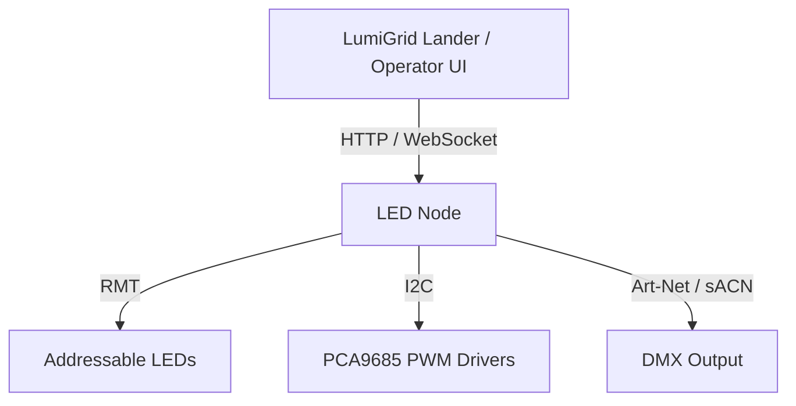

# LumiGrid Architecture

> **Status:** **IMPLEMENTED** (Unless explicitly marked as PLANNED, PARTIALLY IMPLEMENTED, or CONCEPTUAL)

The LumiGrid ecosystem consists of modular nodes designed for robust, real-time lighting control. Currently, the **LED Node** is the canonical implementation and the focus of the system.

## High-Level Topology



## Internal Node Architecture

```text
LumiGrid
│
┌──────────────┴──────────────┐
│                             │
Embedded Node UI        External/Lander UI
FactoryApi              SvelteKit
│                             │
┌─────┴─────────────┐         │
│                   │         │
Signage Runtime     Factory Runtime
Effect Renderer     Factory Effects
Output Controller   Diagnostics
│                   │
┌─────┼─────────────┐         │
│     │             │         │
RMT   PWM           DMX       │
│     │             │         │
LEDs  PCA9685       Art-Net/sACN
```

## System Budgets

To ensure stable operation on embedded hardware, the system enforces the following JSON budgets:
- Normal API response `< 8 KB`
- Large diagnostic response `< 16 KB`
- Backup payload `< 32 KB`
- WebSocket frame `< 4 KB`
- JSON request body `< 8 KB`
