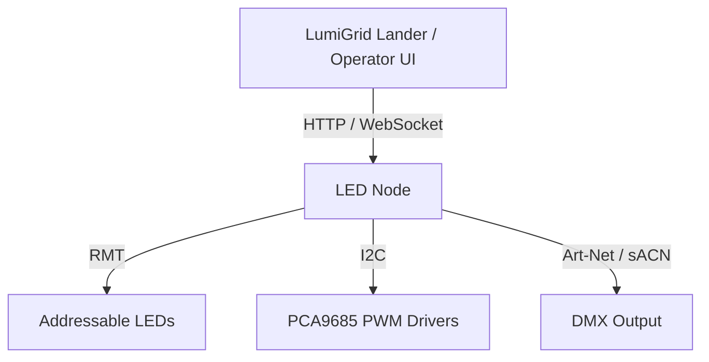

# LumiGrid Architecture

> **Status:** **IMPLEMENTED** (Unless explicitly marked as PLANNED, PARTIALLY IMPLEMENTED, or CONCEPTUAL)

The LumiGrid ecosystem consists of modular nodes designed for robust, real-time lighting control. Currently, the **LED Node** is the canonical implementation and the focus of the system.

## High-Level Topology



## Internal Node Architecture

```text
LumiGrid
│
┌──────────────┴──────────────┐
│                             │
Embedded Node UI        External/Lander UI
FactoryApi              SvelteKit
│                             │
┌─────┴─────────────┐         │
│                   │         │
Signage Runtime     Factory Runtime
Effect Renderer     Factory Effects
Output Controller   Diagnostics
│                   │
┌─────┼─────────────┐         │
│     │             │         │
RMT   PWM           DMX       │
│     │             │         │
LEDs  PCA9685       Art-Net/sACN
```

## System Budgets & Hardware Constraints

To ensure stable operation on embedded hardware, the system enforces the following JSON budgets and physical hardware constraints:
- Normal API response `< 8 KB`
- Large diagnostic response `< 16 KB`
- Backup payload `< 32 KB`
- WebSocket frame `< 4 KB`
- JSON request body `< 8 KB`

### Physical Output Engine Contracts (LG-038)
- **Addressable Outputs**: 8 parallel RMT lanes, canonical maximum **256 pixels per lane** (2,048 pixels total). Submit-all-then-wait parallel transmission.
- **PWM Auxiliary Outputs**: 8 channels via PCA9685 at standard-mode **100 kHz I2C** clock, ~1017 Hz PWM frequency (prescale 5). Direct GPIO `/OE` line fast cutoff (<1 µs).
- **Framerate & Timing**: Target 40.0 FPS (25.0 ms frame period). Frame scheduler detects deadline misses and rebases without burst cycles.
- **Safety Realities**: Software E-Stop and PCA `/OE` cut off immediately; addressable blackout is serial protocol bound (~7.68 ms WS2812 / ~10.24 ms SK6812 for 256 pixels). Sub-5ms addressable physical cutoff requires future hardware load-switch / power-gate.

